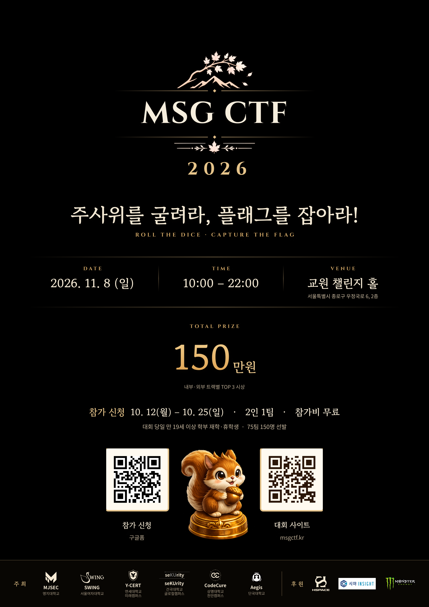
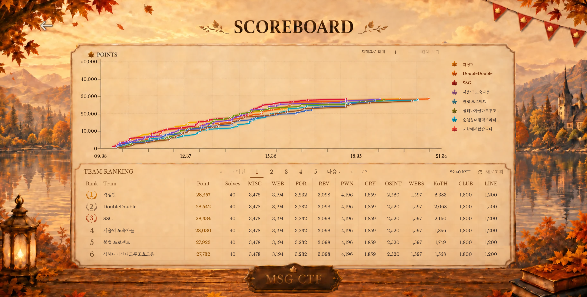
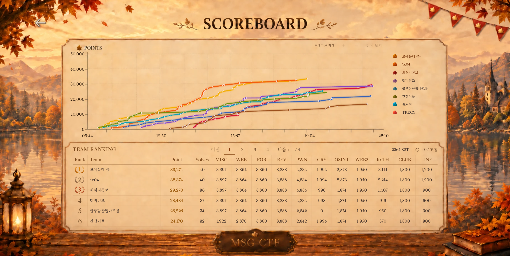
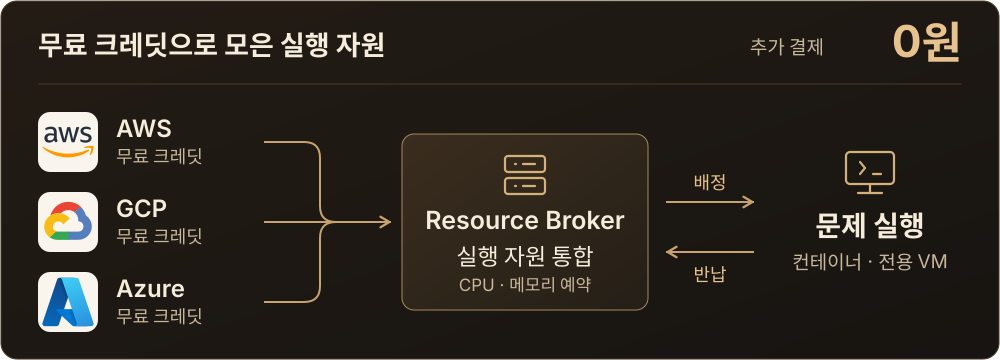
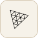
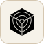

<h1>MSG CTF 2026</h1>

<strong>보드게임형 해킹 대회 · 75팀 150명</strong>

2026. 11. 08 · 10:00 ~ 22:00 KST

<a href="https://msg-ctf.github.io/">대회 기록</a> · <a href="https://msg-ctf.github.io/authors.html">출제자</a> · <a href="https://msg-ctf.github.io/challenges.html">문제 아카이브</a> · <a href="https://msg-ctf.github.io/platform.html">플랫폼</a>

 
<h2 align="center">Overview</h2>

<table align="center">
<tr><th></th><th width="280">External</th><th width="280">Internal</th></tr>
<tr><th>Participants</th><td align="center"><b>50팀 · 100명</b></td><td align="center"><b>25팀 · 50명</b></td></tr>
<tr><th>Challenges</th><td colspan="2" align="center">일반 문제 30개 · KOTH 6개</td></tr>
</table>

주최 · MJSEC · SWING · Y-CERT · seKUrity · CodeCure · Aegis 후원 · HSPACE · 시야인사이트 · MONSTER ENERGY

<h3 align="center">Final Scoreboard</h3>

<table align="center">
<tr><th width="420">External</th><th width="420">Internal</th></tr>
<tr><td align="center"></td><td align="center"></td></tr>
</table>

 

<a href="docs/cloud-cost.md">
<picture>
<source media="(max-width: 600px)" srcset="assets/cloud-credits-mobile.svg">

</picture>
</a>

크레딧 적용 후 추가 결제액 기준 · <a href="docs/cloud-cost.md">운영 구조 ↗</a>

 
<h2 align="center">Archive</h2>

<table align="center">
<tr><th width="260">Challenges</th><th width="260">Platform</th><th width="260">Development</th></tr>
<tr><td align="center"><a href="https://msg-ctf.github.io/challenges.html">지문·출제자</a></td><td align="center"><a href="https://msg-ctf.github.io/platform.html">보드·주사위·KOTH</a></td><td align="center"><a href="docs/platform.md">개발·운영 기록</a></td></tr>
</table>

 

<h2 align="center">Contributors</h2>

<!-- TEAM_CREDITS -->

 &nbsp; <b>jongcoding</b> · <a href="https://github.com/MSG-CTF"><b>PM</b></a> 팀 조율 · 플랫폼 통합 · 운영·QA

<table align="center">
<tr><th align="center" colspan="12"><a href="https://github.com/MSG-CTF/front-team">Frontend</a></th></tr>
<tr>
<td align="center" valign="top" colspan="6" width="390"> <b>tortoiese</b> 참가자·관리자 UI API 연결</td>
<td align="center" valign="top" colspan="6" width="390"> <b>yes0r</b> 보드·3D KOTH·순위·부스 화면</td>
</tr>
<tr><th align="center" colspan="12"><a href="https://github.com/MSG-CTF/msg-backend">Backend</a></th></tr>
<tr>
<td align="center" valign="top" colspan="3" width="195"> <b>gimgyumin0207</b> 문제·인스턴스 배포 버전</td>
<td align="center" valign="top" colspan="3" width="195"> <b>samdi70</b> 인증·팀 마일리지·QR</td>
<td align="center" valign="top" colspan="3" width="195"> <b>jiwonnii</b> 보드·보상 KOTH 채점</td>
<td align="center" valign="top" colspan="3" width="195"> <b>dnehdx</b> 점수·순위 조회 성능</td>
</tr>
<tr><th align="center" colspan="12"><a href="https://github.com/MSG-CTF/msgctf-devsecops">DevSecOps</a> &nbsp; <a href="https://github.com/MSG-CTF/jm_devsecops/tree/main">플랫폼 CI</a></th></tr>
<tr>
<td align="center" valign="top" colspan="4" width="260"> <b>wlsdnd2367</b> 문제 CI 이미지 검사·발행</td>
<td align="center" valign="top" colspan="4" width="260"> <b>woalseee</b> 플랫폼 CI VM 자동 배포</td>
<td align="center" valign="top" colspan="4" width="260"> <b>Giheon-Jeon</b> 프론트 CI 프록시·보안 검사</td>
</tr>
<tr><th align="center" colspan="3"><a href="https://github.com/MSG-CTF/resource-broker">Resource Broker</a></th><th align="center" colspan="3"><a href="https://github.com/MSG-CTF/instance-scheduler">Scheduler</a></th><th align="center" colspan="3"><a href="https://github.com/MSG-CTF/secure-provisioner/tree/dev">Runtime</a></th><th align="center" colspan="3"><a href="https://github.com/MSG-CTF/sentinel">SLA</a> &nbsp; <a href="https://github.com/MSG-CTF/ctf-mock">Mock API</a></th></tr>
<tr>
<td align="center" valign="top" colspan="3" width="195"> <b>gonas0919</b> 인벤토리 예약·반납</td>
<td align="center" valign="top" colspan="3" width="195"> <b>tember8003</b> 생성·초기화 만료·정리</td>
<td align="center" valign="top" colspan="3" width="195"> <b>goldsimchoi</b> K3s 격리 Gateway · Windows</td>
<td align="center" valign="top" colspan="3" width="195"> <b>minsoo0506</b> SLA 초기 구조 상태 수집</td>
</tr>
</table>
<!-- END_TEAM_CREDITS -->

<a href="https://msg-ctf.github.io/authors.html">출제자</a> · <a href="docs/platform.md#개인별-기여-기록">기여 기록</a>

<h2 align="center">Tech Stack</h2>

<!-- TECH_STACK -->
<table align="center">
<tr><th align="left" width="135">Frontend</th><td align="center" width="640">
 &nbsp;  &nbsp;  &nbsp;  React · Vite · Tailwind CSS · Three.js
</td></tr>
<tr><th align="left" width="135">Backend</th><td align="center" width="640">
 &nbsp;  &nbsp;  Django REST · PostgreSQL · Redis
</td></tr>
<tr><th align="left" width="135">Infrastructure</th><td align="center" width="640">
 &nbsp;  &nbsp;  &nbsp;  &nbsp;  &nbsp;  &nbsp;  FastAPI · Kotlin · Spring Boot · Go · Docker · K3s · Nginx
</td></tr>
<tr><th align="left" width="135">DevSecOps</th><td align="center" width="640">
 &nbsp;  GitHub Actions · Trivy GHCR · Gitleaks · SBOM
</td></tr>
<tr><th align="left" width="135">Monitoring</th><td align="center" width="640">
 &nbsp;  &nbsp;  ASP.NET Core · Prometheus · Grafana
</td></tr>
</table>
<!-- END_TECH_STACK -->

<a href="docs/readme-updates.md">저장소별 기여</a> · <a href="docs/asset-sources.md">화면·에셋 출처</a>

