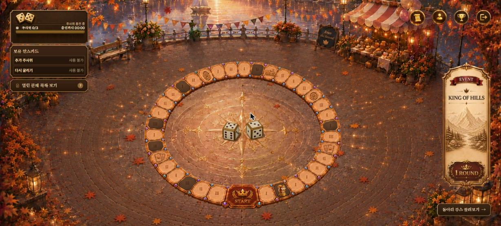

<h1>MSG CTF 2026</h1>

<strong>75팀·150명이 참가한 보드게임형 해킹 대회</strong>

2026. 11. 08 · 10:00 ~ 22:00 KST

<a href="https://msg-ctf.github.io/">대회 기록</a> · <a href="https://msg-ctf.github.io/authors.html">출제자</a> · <a href="https://msg-ctf.github.io/challenges.html">문제 아카이브</a> · <a href="https://msg-ctf.github.io/platform.html">플랫폼</a>

주사위로 이동하고, 문제를 풀고, 모은 마일리지로 동아리 부스를 즐겼습니다

 
<h2 align="center">Overview</h2>

<table align="center">
<tr><th></th><th width="280">External</th><th width="280">Internal</th></tr>
<tr><th>Participants</th><td align="center"><b>50팀 · 100명</b></td><td align="center"><b>25팀 · 50명</b></td></tr>
<tr><th>Challenges</th><td colspan="2" align="center">일반 문제 30개 · KOTH 6개</td></tr>
<tr><th>Cloud</th><td colspan="2" align="center"><b>추가 결제액 0원</b> 무료 크레딧 적용 후 실제 추가 결제액 기준</td></tr>
</table>

주최 · MJSEC · SWING · Y-CERT · seKUrity · CodeCure · Aegis 후원 · HSPACE · 시야인사이트 · MONSTER ENERGY

 

<h2 align="center">Contributors</h2>

<!-- TEAM_CREDITS -->
<table align="center"><tr><td align="center" width="240">
 <b>jongcoding</b> <b>Lead</b> 팀 조율 플랫폼 통합 운영·QA
</td></tr></table>

<table align="center"><tr>
<td align="center" valign="top" width="260"><h3>Frontend</h3>
참가자·관리자 화면

 <b>tortoiese</b> 참가자·관리자 UI API 연결

 <b>yes0r</b> 보드·3D KOTH·순위·부스 화면
</td>
<td align="center" valign="top" width="260"><h3>Backend</h3>
대회 규칙과 서비스 API

 <b>gimgyumin0207</b> 문제·인스턴스 배포 버전

 <b>samdi70</b> 인증·팀 마일리지·QR

 <b>jiwonnii</b> 보드·보상 KOTH 채점

 <b>dnehdx</b> 점수·순위 조회 성능
</td>
<td align="center" valign="top" width="260"><h3>DevSecOps</h3>
검사부터 발행·자동 배포까지

 <b>wlsdnd2367</b> 문제 CI 이미지 검사·발행

 <b>woalseee</b> 플랫폼 CI VM 자동 배포

 <b>Giheon-Jeon</b> 프론트 CI 프록시·보안 검사
</td>
</tr></table>

<table align="center"><tr>
<td align="center" valign="top" width="195"><h3>Resource Broker</h3>
클라우드 자원 배정

 <b>gonas0919</b> 인벤토리 예약·반납
</td>
<td align="center" valign="top" width="195"><h3>Scheduler</h3>
문제 실행 요청과 상태 관리

 <b>tember8003</b> 생성·초기화 만료·정리
</td>
<td align="center" valign="top" width="195"><h3>Runtime</h3>
문제 실행과 격리 보안

 <b>goldsimchoi</b> K3s 격리 Gateway Windows
</td>
<td align="center" valign="top" width="195"><h3>SLA</h3>
서비스 상태와 장애 감시

 <b>minsoo0506</b> SLA 초기 구조 상태 수집
</td>
</tr></table>
<!-- END_TEAM_CREDITS -->

<a href="https://msg-ctf.github.io/authors.html">출제자 30명과 만든 문제</a> · <a href="docs/platform.md#개인별-기여-기록">개인별 기여 기록</a>

 
<h2 align="center">Tech Stack</h2>

<!-- TECH_STACK -->
<table align="center">
<tr><th align="left" width="135">Frontend</th><td align="center" width="640">
 &nbsp;  &nbsp;  &nbsp;  React · Vite · Tailwind CSS · Three.js
</td></tr>
<tr><th align="left" width="135">Backend</th><td align="center" width="640">
 &nbsp;  &nbsp;  Django REST · PostgreSQL · Redis
</td></tr>
<tr><th align="left" width="135">Infrastructure</th><td align="center" width="640">
 &nbsp;  &nbsp;  &nbsp;  &nbsp;  &nbsp;  &nbsp;  FastAPI · Kotlin · Spring Boot · Go · Docker · K3s · Nginx
</td></tr>
<tr><th align="left" width="135">DevSecOps</th><td align="center" width="640">
 &nbsp;  GitHub Actions · Trivy GHCR · Gitleaks · SBOM
</td></tr>
<tr><th align="left" width="135">Monitoring</th><td align="center" width="640">
 &nbsp;  &nbsp;  ASP.NET Core · Prometheus · Grafana
</td></tr>
</table>
<!-- END_TECH_STACK -->

 
<h2 align="center">Archive</h2>

<table align="center">
<tr><th width="260">Challenges</th><th width="260">Platform</th><th width="260">Development</th></tr>
<tr><td align="center"><a href="https://msg-ctf.github.io/challenges.html">문제 지문과 출제자</a> 일반 문제 30개 · KOTH 6개</td><td align="center"><a href="https://msg-ctf.github.io/platform.html">플랫폼 둘러보기</a> 보드 · 주사위 · 문제 풀이</td><td align="center"><a href="docs/platform.md">개발·운영 기록</a> 구성 · 장애 복구 · 성능 검증</td></tr>
</table>

최종 스코어보드

| External · 50팀 / 100명 | Internal · 25팀 / 50명 |
| --- | --- |
|  |  |

<a href="docs/readme-updates.md">저장소별 기여</a> · <a href="docs/asset-sources.md">화면·에셋 출처</a>

