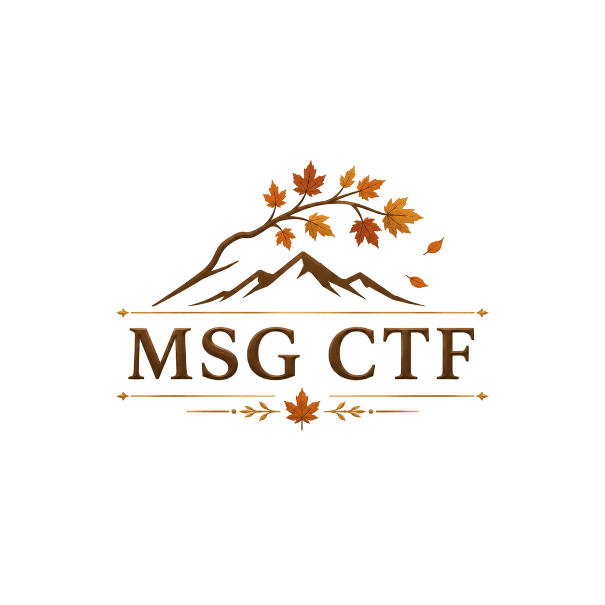

# MSG CTF 2026

**75팀·150명이 참가한 보드게임형 해킹 대회**

2026. 11. 08 · 10:00–22:00 KST

[대회 기록](https://msg-ctf.github.io/) · [출제자](https://msg-ctf.github.io/authors.html) · [문제 아카이브](https://msg-ctf.github.io/challenges.html) · [플랫폼](https://msg-ctf.github.io/platform.html)

두 명씩 한 팀으로 주사위를 굴리고, 도착한 칸에서 문제를 골라 푸는 대회입니다 
일반 문제와 KOTH로 점수를 겨루고, 모은 마일리지로 동아리 부스도 이용했습니다 
참가자 화면부터 문제 배포·채점·운영 감시까지 직접 만들었습니다

## 클라우드 비용 0원으로 마무리

**무료 크레딧 적용 후 실제 추가 결제액 기준입니다**

대회 운영에 사용한 클라우드 비용은 크레딧으로 충당했습니다
실행 자원의 예약·배정·반납, 장애 복구와 성능 개선 과정은 [플랫폼 개발 기록](docs/platform.md)에 남겼습니다

## 대회 결과

| 외부 트랙 | 내부 트랙 |
| --- | --- |
| **50팀 · 100명** | **25팀 · 50명** |
|  |  |

이미지를 누르면 최종 스코어보드를 크게 볼 수 있습니다 
참가해주신 모든 분께 감사드립니다

## 함께 만든 사람들

총괄과 플랫폼 팀별로 맡은 일을 모았습니다 
출제자 30명과 각자 만든 문제는 [출제자 페이지](https://msg-ctf.github.io/authors.html)에서 볼 수 있습니다

<!-- TEAM_CREDITS -->

<h3>총괄</h3>

<a href="https://github.com/jongcoding"><strong>jongcoding</strong></a> 팀 조율 · 플랫폼 통합 · 운영·QA

<table align="center"><tr>
<td valign="top" width="50%">
<h3>프론트팀</h3>

참가자·관리자 화면

<table><tr><td width="78"></td><td><a href="https://github.com/tortoiese"><strong>tortoiese</strong></a> 참가자·관리자 UI · API 연결</td></tr>
<tr><td width="78"></td><td><a href="https://github.com/yes0r"><strong>yes0r</strong></a> 보드·3D · KOTH·순위·부스 화면</td></tr></table>
</td>
<td valign="top" width="50%">
<h3>백엔드팀</h3>

대회 규칙과 서비스 API

<table><tr><td width="78"></td><td><a href="https://github.com/gimgyumin0207"><strong>gimgyumin0207</strong></a> 문제·인스턴스 · 배포 버전</td></tr>
<tr><td width="78"></td><td><a href="https://github.com/samdi70"><strong>samdi70</strong></a> 인증·팀 · 마일리지·QR</td></tr>
<tr><td width="78"></td><td><a href="https://github.com/jiwonnii"><strong>jiwonnii</strong></a> 보드·보상 · KOTH 채점</td></tr>
<tr><td width="78"></td><td><a href="https://github.com/dnehdx"><strong>dnehdx</strong></a> 점수·순위 · 조회 성능</td></tr></table>
</td>
</tr></table>

<table align="center"><tr>
<td valign="top" width="33%">
<h3>리소스 브로커팀</h3>

클라우드 자원 배정

<table><tr><td width="78"></td><td><a href="https://github.com/gonas0919"><strong>gonas0919</strong></a> 인벤토리 · 예약·반납</td></tr></table>
</td>
<td valign="top" width="33%">
<h3>스케줄러팀</h3>

문제 실행 요청과 상태 관리

<table><tr><td width="78"></td><td><a href="https://github.com/tember8003"><strong>tember8003</strong></a> 생성·초기화 · 만료·정리</td></tr></table>
</td>
<td valign="top" width="33%">
<h3>런타임팀</h3>

문제 실행과 격리 보안

<table><tr><td width="78"></td><td><a href="https://github.com/goldsimchoi"><strong>goldsimchoi</strong></a> K3s 격리 · Gateway · Windows</td></tr></table>
</td>
</tr></table>

<table align="center"><tr>
<td valign="top" width="50%">
<h3>DevSecOps팀</h3>

검사부터 발행·자동 배포까지

<table><tr><td width="78"></td><td><a href="https://github.com/wlsdnd2367"><strong>wlsdnd2367</strong></a> 문제 CI · 이미지 검사·발행</td></tr>
<tr><td width="78"></td><td><a href="https://github.com/woalseee"><strong>woalseee</strong></a> 플랫폼 CI · VM 자동 배포</td></tr>
<tr><td width="78"></td><td><a href="https://github.com/Giheon-Jeon"><strong>Giheon-Jeon</strong></a> 프론트 CI · 프록시·보안 검사</td></tr></table>
</td>
<td valign="top" width="50%">
<h3>SLA·모니터링팀</h3>

서비스 상태와 장애 감시

<table><tr><td width="78"></td><td><a href="https://github.com/minsoo0506"><strong>minsoo0506</strong></a> SLA 초기 구조 · 상태 수집</td></tr></table>
</td>
</tr></table>
<!-- END_TEAM_CREDITS -->

여러 저장소에 걸친 작업과 관련 PR은 [개인별 기여 기록](docs/platform.md#개인별-기여-기록)과 [저장소별 README](docs/readme-updates.md)에 정리했습니다

## 주최와 후원

| MJSEC | SWING | Y-CERT |
| --- | --- | --- |
| 명지대학교 | 서울여자대학교 | 연세대학교 미래캠퍼스 |

| seKUrity | CodeCure | Aegis |
| --- | --- | --- |
| 건국대학교 글로컬캠퍼스 | 상명대학교 천안캠퍼스 | 단국대학교 |

**후원 · HSPACE · 시야인사이트 · MONSTER ENERGY**

## 기록

| 내용 | 바로가기 |
| --- | --- |
| 일반 문제 30개와 KOTH 6개 | [문제 지문·출제자·제공 파일 안내](https://msg-ctf.github.io/challenges.html) |
| 보드 등장·주사위·문제 풀이 화면 | [플랫폼 둘러보기](https://msg-ctf.github.io/platform.html) |
| 시스템 구성·장애 복구·성능 검증 | [플랫폼 개발·운영 기록](docs/platform.md) |
| 저장소별 역할과 기여자 | [저장소별 README](docs/readme-updates.md) |
