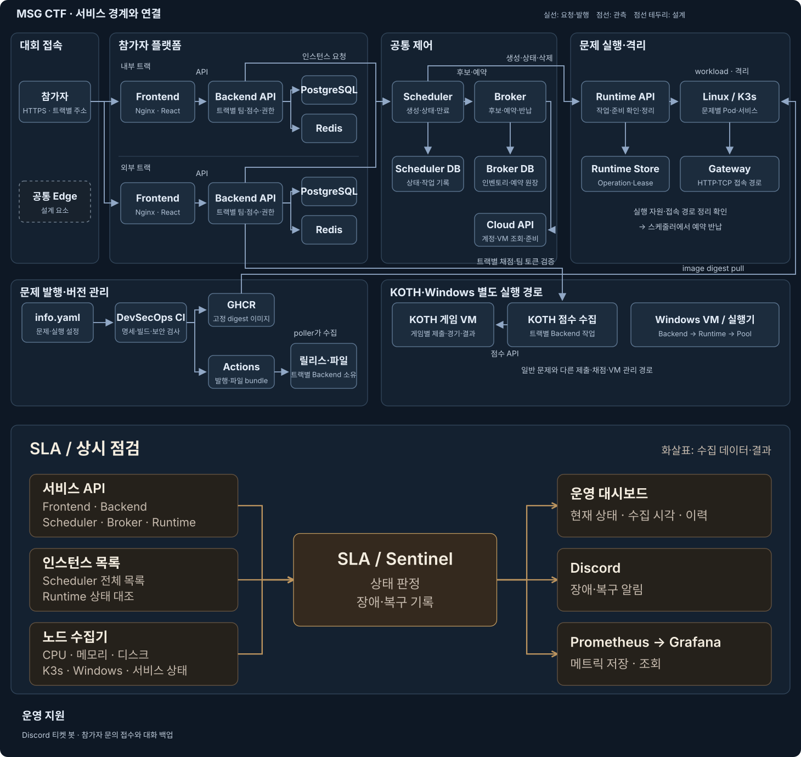

# 플랫폼 개발·운영 기록

[대회 소개](../README.md) · [실제 화면과 구성](https://msg-ctf.github.io/platform.html) · [팀별 참여자](../README.md#함께-만든-사람들)

## 기능

| 참가자 | 관리자·운영자 |
| --- | --- |
| 보드 이동, 주사위 충전, 찬스카드 | 팀·계정·대회 설정과 감사 로그 |
| 일반 문제 30개, 지문·파일·플래그 제출 | GitHub 발행본 가져오기와 배포 버전 전환·롤백 |
| 문제 인스턴스 생성·초기화·연장·종료 | 버전별 환경변수·비밀값·제공 파일 설정 |
| KOTH 6개, 문제별 팀 토큰과 순위 | 관리자 미리보기, 배포 시험과 정리 재시도 |
| 동아리 부스·시그니처 문제·마일리지·QR | 상품 선택 결제, 실행 노드·예약·서비스 상태 확인 |

내부·외부 트랙은 계정과 팀, 점수와 데이터 저장소를 분리해 운영했습니다

## 클라우드 추가 결제 0원

AWS·GCP·Azure 무료 크레딧으로 확보한 실행 자원을 브로커에 연결했습니다
문제가 끝나면 자원을 정리하고 예약을 반납해 다음 요청에 썼습니다

[크레딧 활용과 자원 운영 방식](cloud-cost.md)

## 플랫폼 전체 구성

[구성도 크게 보기](../assets/architecture.svg)

내부·외부 트랙은 Frontend·Backend·PostgreSQL·Redis를 각각 두고, 스케줄러·브로커·런타임을 공통 제어 영역으로 연결했습니다
스케줄러 DB·브로커 DB·Runtime Store에는 실행 상태와 예약·작업 기록을 보관합니다
문제 발행본은 별도 Registry 서버를 거치지 않고 각 백엔드가 가져와 릴리스와 제공 파일로 관리합니다

KOTH 채점은 트랙별 백엔드 작업이며, 게임 VM의 점수 API와 연결됩니다
Windows는 일반 컨테이너 생성과 구분된 VM 실행 경로를 사용합니다
SLA는 서비스 API·전체 인스턴스 목록·노드 보고를 주기적으로 수집합니다
상태와 장애·복구 이력은 운영 화면에, 알림은 Discord에 보냅니다
Prometheus가 Sentinel 메트릭을 수집하고 Grafana에서 조회합니다 · [구현 근거](sla-flow.md)

공통 Edge와 Active/Standby 자동 승격은 설계·추가 검증 범위로 구분합니다

## 문제 배포와 실행

1. 출제자가 문제 저장소에 코드를 올리면 CI가 명세와 이미지를 검사합니다
2. 통과한 이미지는 GHCR에 digest로 고정해 발행하고, 참가자 제공 파일도 별도 묶음으로 만듭니다
3. 백엔드가 발행본을 수집해 문제·배포 버전·파일·실행 설정을 연결합니다
4. 참가자가 실행을 누르면 스케줄러가 브로커에서 자원을 예약하고 런타임에 생성을 요청합니다
5. 런타임이 컨테이너별 설정과 비밀값을 주입하고, 준비가 끝난 접속 주소를 돌려줍니다
6. 종료·만료 뒤 실제 실행 자원과 접속 경로를 정리한 것을 확인하고 예약을 반납합니다

정적 문제는 인스턴스를 만들지 않고 파일을 제공합니다
KOTH는 별도 게임 서버와 제출·채점 경로를 사용합니다

## 저장소별로 맡은 일

| 저장소 | 맡은 일 |
| --- | --- |
| [msg-backend](https://github.com/MSG-CTF/msg-backend) | 인증·팀·보드·문제·점수·마일리지, 발행본 수집과 관리자 API |
| [front-team](https://github.com/MSG-CTF/front-team) | 참가자·관리자 화면, 보드·문제 풀이·부스·KOTH 연결 |
| [instance-scheduler](https://github.com/MSG-CTF/instance-scheduler) | 생성·초기화·만료·정리, 실행 상태 추적과 예약 반납 |
| [resource-broker](https://github.com/MSG-CTF/resource-broker) | 클라우드 인벤토리·후보 조회·자원 예약·확정·반납 |
| [secure-provisioner](https://github.com/MSG-CTF/secure-provisioner/tree/dev) | K3s 배포·격리·비밀값 주입·Gateway·실행 자원 정리 |
| DevSecOps · [msgctf-devsecops](https://github.com/MSG-CTF/msgctf-devsecops) · [jm_devsecops](https://github.com/MSG-CTF/jm_devsecops/tree/main) | 문제 이미지 검사·GHCR 발행·SBOM·참가자 파일 묶음, 플랫폼 자동 배포·전환·롤백 |
| [sentinel](https://github.com/MSG-CTF/sentinel) | 실제 서비스·노드·인스턴스 감시, 대시보드·이벤트·알림 |
| [ctf-mock](https://github.com/MSG-CTF/ctf-mock) | SLA 초기 개발용 API와 장애 시나리오 시험 |
| [2026_MSG_CTF](https://github.com/MSG-CTF/2026_MSG_CTF) | 출제 문제·제공 파일·실행 설정·발행 워크플로, 접근 권한 필요 |

저장소별 참여자와 관련 PR은 [README 변경 목록](readme-updates.md)에서 확인할 수 있습니다

## 운영 전 수정한 문제

| 상황 | 반영한 내용 | 기록 |
| --- | --- | --- |
| 주사위를 쓴 뒤 응답이 끊기고 다른 브라우저에서 재시도 | 요청과 결과를 서버에 보관하고, 같은 요청은 같은 결과로 복구 | [백엔드 #122](https://github.com/MSG-CTF/msg-backend/pull/122) · [프론트 #150](https://github.com/MSG-CTF/front-team/pull/150) |
| 이전 이동의 늦은 확정 요청이 다음 이동에 도착 | 이동 회차별 확정 키를 발급해 다른 회차의 요청을 구분 | [백엔드 #123](https://github.com/MSG-CTF/msg-backend/pull/123) |
| 생성·초기화 접수 뒤 응답 유실이나 백엔드 재시작 | 작업 ID로 접수 결과를 찾고, 미접수 확인과 소유 범위 검사 후 복구 | [스케줄러 #95](https://github.com/MSG-CTF/instance-scheduler/pull/95) · [백엔드 #263](https://github.com/MSG-CTF/msg-backend/pull/263) |
| 실행 자원은 지워졌지만 브로커 예약이 남음 | 반납 의도를 DB에 보관하고 확인될 때까지 같은 요청으로 재시도 | [스케줄러 #87](https://github.com/MSG-CTF/instance-scheduler/pull/87) |
| 문제 기동·삭제 대기 시간이 길어짐 | 기동 때만 CPU를 늘리고 준비 뒤 원복, K3s 내부 정리 대기 조정 | [스케줄러 #92](https://github.com/MSG-CTF/instance-scheduler/pull/92) · [런타임 #117](https://github.com/MSG-CTF/secure-provisioner/pull/117) |
| 최근 인스턴스만 감시해 오래된 정리 대기가 빠짐 | 전체 페이지 조회와 중복·커서 반복·중간 실패 검사 | [SLA #18](https://github.com/MSG-CTF/sentinel/pull/18) |
| KOTH 제출 부하가 조회와 헬스체크까지 막음 | 제출과 조회 요청을 분리하고 DB 연결·실행 슬롯 처리 보완 | [런타임 #121](https://github.com/MSG-CTF/secure-provisioner/pull/121) |

이 과정에서 실제 사이트와 독립된 검증 계정으로 동시 요청, 두 브라우저 재시도, 응답 유실과 서비스 재시작을 시험했습니다
정상 응답뿐 아니라 중복 생성·보상, 남은 자원과 예약도 함께 확인했습니다

## 성능 검증

| 사례 | 비교 결과 | 검증 조건 |
| --- | --- | --- |
| Open House 생성 중앙값 | 52.7초 → 23.1초 | 세 문제 총 12개 동시 생성 중 Open House 4개, 기동 CPU 부스트 전후 |
| Cashout 삭제 중앙값 | 34.98초 → 12.39초 | SQLite 기반 전용 K3s 노드에서 12개 동시 종료 |
| Cashout 삭제 최대 시간 | 40.04초 → 14.82초 | 같은 종료 비교 시험 |

각 시험 환경에서 관측한 값입니다
생성·접속 뒤 CPU 원복, 실제 Namespace·접속 경로 삭제와 예약 반납까지 확인했습니다
조건과 남은 항목은 [기동 CPU 시험](https://github.com/MSG-CTF/instance-scheduler/pull/92)과 [삭제 대기 시험](https://github.com/MSG-CTF/secure-provisioner/pull/117)에 남겼습니다

## 개인별 기여 기록

기여 내용은 2026-11-09까지의 병합 PR과 커밋을 기준으로 정리했습니다
한 사람이 여러 저장소에 참여했으며, 아래 표는 플랫폼 개발·운영에서 맡은 일을 담았습니다

| 참여자 | 플랫폼에서 맡은 일 |
| --- | --- |
|  [jongcoding](https://github.com/jongcoding) | PM, 플랫폼 연동·운영·QA, 장애 재현과 복구, 성능 개선, SLA·배포 연결 |
|  [gimgyumin0207](https://github.com/gimgyumin0207) | 문제·인스턴스 API, 발행본·제공 파일·배포 버전 관리 |
|  [samdi70](https://github.com/samdi70) | 인증·팀·관리자 API, 마일리지·QR 결제 |
|  [jiwonnii](https://github.com/jiwonnii) | 보드 규칙·보상과 KOTH API·채점·문제별 토큰 |
|  [dnehdx](https://github.com/dnehdx) | 점수·조회 성능, 로그인 제한과 프론트 보안 정책 |
|  [tortoiese](https://github.com/tortoiese) | 참가자·관리자 화면, 문제·보드 UI와 API 연결 |
|  [yes0r](https://github.com/yes0r) | 보드·KOTH·순위·부스 화면과 3D 구성 |
|  [tember8003](https://github.com/tember8003) | 스케줄러 생성·초기화·만료·정리와 상태 이력 |
|  [gonas0919](https://github.com/gonas0919) | 리소스 브로커, 클라우드 인벤토리·예약·관리 콘솔 |
|  [goldsimchoi](https://github.com/goldsimchoi) | Go 런타임·K3s 격리·Gateway·Windows 실행 연결 |
|  [wlsdnd2367](https://github.com/wlsdnd2367) | 문제 CI·이미지 검사·SBOM·발행과 노드 사전 준비 |
|  [woalseee](https://github.com/woalseee) | 플랫폼 공통 CI와 프론트·백엔드 VM 자동 배포 |
|  [Giheon-Jeon](https://github.com/Giheon-Jeon) | 프론트 CI·Nginx 프록시·Semgrep 검사 연결 |
|  [minsoo0506](https://github.com/minsoo0506) | SLA 초기 구조·health worker·Prometheus와 장애 모사 API |

문제 출제·수정·검수에 참여한 분들은 [문제 저장소의 기여자 목록](https://github.com/MSG-CTF/2026_MSG_CTF/blob/main/.github/README.md#함께-만든-사람들)에 따로 정리했습니다

문제 출제·수정·검수 참여자

[goldsimchoi](https://github.com/goldsimchoi) · [jongcoding](https://github.com/jongcoding) · [wlsdnd2367](https://github.com/wlsdnd2367) · [gonas0919](https://github.com/gonas0919) · [cksk00](https://github.com/cksk00) · [Ranunculus2165](https://github.com/Ranunculus2165) · [YeonHo0718](https://github.com/YeonHo0718) · [s3tzun4](https://github.com/s3tzun4) · [yebbis](https://github.com/yebbis) · [banda59](https://github.com/banda59) · [Z3r0c0k3](https://github.com/Z3r0c0k3) · [random6-xyz](https://github.com/random6-xyz) · [meeeeing](https://github.com/meeeeing) · [veomeow](https://github.com/veomeow) · [seolwon05](https://github.com/seolwon05) · [sea-2025](https://github.com/sea-2025) · [guswjddl4313](https://github.com/guswjddl4313) · [Hayk6c1](https://github.com/Hayk6c1) · [yes0r](https://github.com/yes0r) · [yeon365](https://github.com/yeon365) · [xo0102](https://github.com/xo0102) · [chaeun-11](https://github.com/chaeun-11) · [zkfla](https://github.com/zkfla) · [nomadY24](https://github.com/nomadY24) · [stw0218](https://github.com/stw0218) · [lucylucy1006-netizen](https://github.com/lucylucy1006-netizen) · [tls456](https://github.com/tls456) · [cooku222](https://github.com/cooku222) · [hhi3xn](https://github.com/hhi3xn) · [Hyeo0n](https://github.com/Hyeo0n) · [hhieon](https://github.com/hhieon) · [Whaql123](https://github.com/Whaql123)

## 사용한 기술

| 영역 | 기술 |
| --- | --- |
| 화면 | React · Vite · Tailwind CSS · Three.js |
| 백엔드·데이터 | Django REST Framework · PostgreSQL · Redis |
| 자원 관리 | FastAPI · SQLAlchemy · Kotlin · Spring Boot |
| 실행·격리 | Go · K3s · Docker · Nginx |
| 빌드·배포 | GitHub Actions · GHCR · Trivy · Gitleaks · SBOM |
| 관측 | C# · ASP.NET Core · Prometheus · Grafana |

문제 코드, 배포 설정, 참가자 제공 파일을 버전별로 연결하고, 운영에 쓰는 비밀값은 발행 이미지와 분리해 관리했습니다
